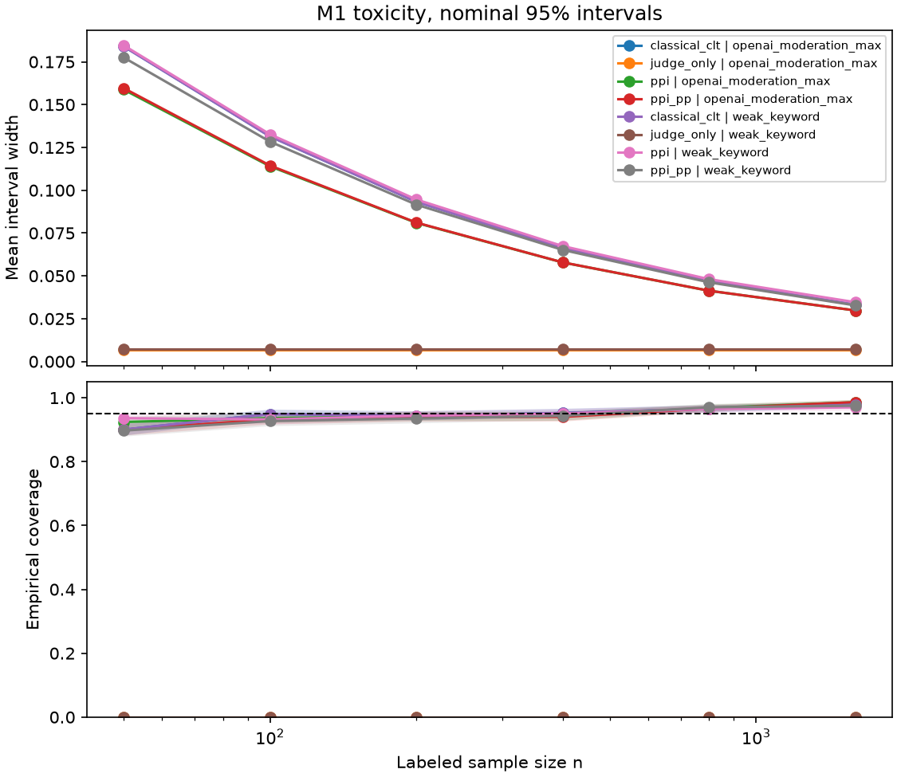

# Label-efficient evaluation

**Question.** How many human labels does a decision need when a cheap judge
scores every item?

**Headline (Milestone 1, locked definition, $n = 200$).** After the full
$R = 1000$ grid, no active judge met the coverage criterion for PPI++
(empirical 95% coverage within one Monte Carlo SE of 95%). **No labels-saved
percentage is reported.** See [`analysis_plan.md`](analysis_plan.md) and
[`docs/m1-run-notes.md`](docs/m1-run-notes.md).



Working title: How many human labels does a decision need?

## Milestone 1 status

ToxicChat prevalence (`lmsys/toxic-chat`, subset `toxicchat0124`).

| Item | Status |
| --- | --- |
| Analysis plan | Locked; headline at $n = 200$ |
| Population | `human_annotation == True` (train+test pooled); HF card verified |
| Judges | `openai_moderation` max category score; weak keyword; Llama Guard / open IT stubs |
| Estimators | Classical (CLT, Wilson), judge-only, PPI, PPI++ (`ppi_py` cross-check) |
| Simulation | Full grid $R = 1000$ in `outputs/m1/metrics_full.csv`; smoke $R = 5$ also kept |
| Figure | `make figures` → `outputs/m1/figure_m1.png` |

Fixed seeds: `SEED_ROOT = 20261026`; subset draw $r$ at budget $n$ uses
`seed = SEED_ROOT + 1_000_003 * n + r`.

## Setup

```bash
uv sync --extra dev
make data          # download ToxicChat; write load report (gitignored raw cache)
make test
make m1-full       # R=1000 (or `make m1` for smoke R=5)
make figures
```

Raw ToxicChat rows are not committed (CC BY-NC 4.0). Download scripts only.

## Method (short)

Estimand: prevalence of toxicity and jailbreaking in the human-annotated
subset. Estimator:

```
theta_hat(lambda) = mean_n(Y) - lambda * ( mean_n(f(X)) - mean_N(f(X_unlabeled)) )
```

Classical uses human labels only. PPI sets $\lambda = 1$. PPI++ power-tunes
$\lambda$. Judge-only uses $f$ alone (biased diagnostic).

This project applies published PPI / PPI++ methods; it is not a new estimator.
See [`analysis_plan.md`](analysis_plan.md) for Milestones 2 and 3 stubs.
