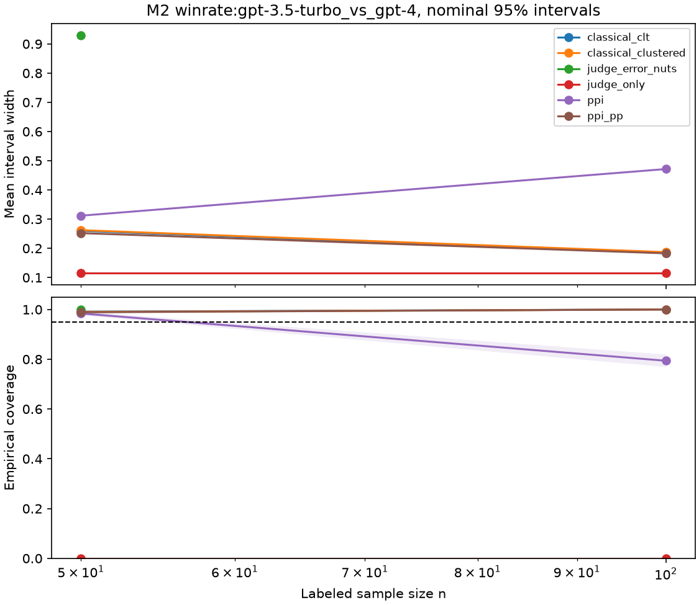

# Label-efficient evaluation

**Question.** How many human labels does a decision need when a model (LLM
judge or outcome predictor) scores every item?

## Milestone 1

Headline TBD after the locked ToxicChat prevalence grid (see
`analysis_plan.md`).

## Milestone 2 (MT-Bench)

**Pair.** gpt-3.5-turbo vs gpt-4 (canonical), N = 105 decisive human-majority
units; truth win rate for gpt-3.5-turbo given a non-tie = 0.3238.

**Inter-human agreement (ceiling).** On multi-labeled units, humans agree
65.5% of the time three-way and **82.7%** when both votes are non-tie. That is
the practical ceiling for any LLM judge on this data.

**PPI++ headline at n = 50 (locked amended budget).** No judge meets nominal
95% coverage within Monte Carlo SE under PPI++ (full grid R = 1000:
ppi_pp coverage 0.989, SE 0.003, mean width 0.252). **No labels-saved
percentage is reported.** Judge-only GPT-4 scores are badly biased.

**Bradley-Terry (human majority, non-tie).** Ordering by strength: gpt-4,
claude-v1, gpt-3.5-turbo, vicuna-13b-v1.2, alpaca-13b, llama-13b (cluster-
bootstrap SEs in `outputs/m2/bradley_terry.json`).

**Hierarchical judge-error (NumPyro).** Dawid-Skene style NUTS fit (pooled
human class + GPT-4). Full-data 95% interval covers the human-majority
truth. Under the same n=50 subsampling as PPI++, posterior intervals are
much wider (mean width 0.93 vs PPI++ 0.25 at R=20) and do not improve on
PPI++. Details in `docs/m2-mt-bench-report.md`.

See [`analysis_plan.md`](analysis_plan.md) for locked design. Raw data are
not committed; `make data-m2` downloads and verifies.
