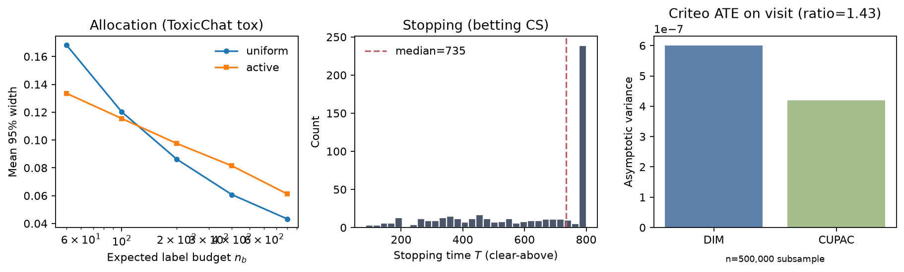

# Label-efficient evaluation

**Question.** How many human labels does a decision need when a model (LLM
judge or outcome predictor) scores every item?

This branch ships Milestone 3 (allocation, stopping, Criteo CUPAC). Designs are
locked in [`analysis_plan.md`](analysis_plan.md). Full-grid numbers:

- **Allocation** (ToxicChat toxicity, $n_b=200$): active AIPW **coverage fail**
  (empirical 0.888 vs nominal 0.95; uniform 0.962). No width-savings claim.
- **Stopping** (betting CS, clear-above $\tau=0.10$): median $T=735$; 45.8% hit
  the cap $t_{\max}=800$; false clear-above rate 0.000 under $R=500$.
- **Criteo** (ATE on `visit`, 500k-row subsample): CUPAC / DIM variance ratio
  **1.43×**; A/A FPR DIM 0.045, CUPAC 0.065; CUPAC≡PPI identity holds.



## Milestone 3

Three studies that share the PPI / control-variate form
`mean(Y) - λ (mean(f_lab) - mean(f_all))`:

1. **Allocation.** Uncertainty-weighted human sampling with AIPW (Zrnic and
   Candès, ICML 2024) vs uniform sampling on ToxicChat toxicity.
2. **Stopping.** Hedged betting confidence sequences (Waudby-Smith and Ramdas)
   on the PPI rectifier stream; stop when the interval clears a threshold.
3. **Criteo bridge.** ATE on `visit`: difference in means vs CUPAC (cross-fit
   ML outcome model). CUPAC, not CUPED (no pre-period). Algebraic and numerical
   identity with the PPI form. A/A on control for nominal 5% FPR.

Regenerate:

```bash
make m3-smoke          # R=5 alloc/stop; Criteo 50k subsample
make m3-full           # locked grids (R=500; Criteo 500k subsample)
make figures-m3
```

Outputs land in `outputs/m3/`. Raw ToxicChat and Criteo files are downloaded
to `data/raw/` (gitignored).

### Databricks

`notebooks/criteo_spark.py` is the PySpark notebook source for Databricks Free
Edition. On this self-hosted machine Databricks was not configured; the default
local path uses a 500k-row reservoir subsample (seed `20261026`) and records
that in the Criteo load report. Use the notebook for a full-file Spark run when
a cluster is available.

## Layout

```
src/lee/
  data/          # ToxicChat, Criteo loaders (no raw data in git)
  estimators/    # classical, PPI, active AIPW, betting CS, CUPAC
  sim/           # m3_allocation, m3_stopping, m3_criteo
  figures/       # m3 figure
notebooks/criteo_spark.py
docs/m3-writeup.md
analysis_plan.md
```
